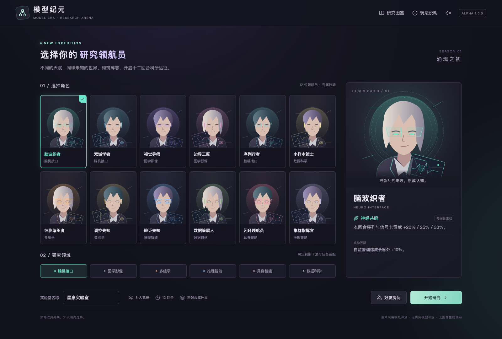
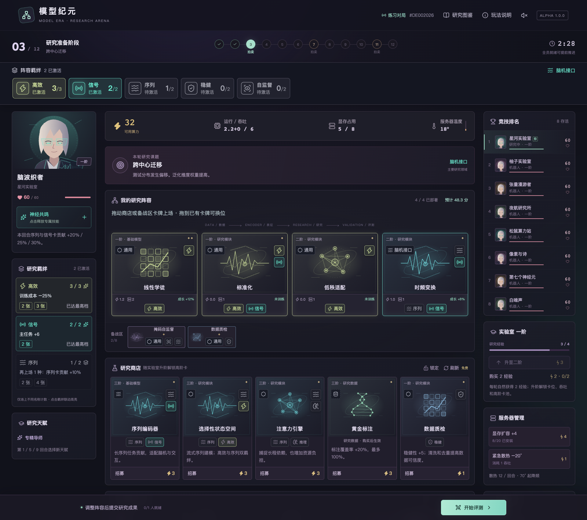
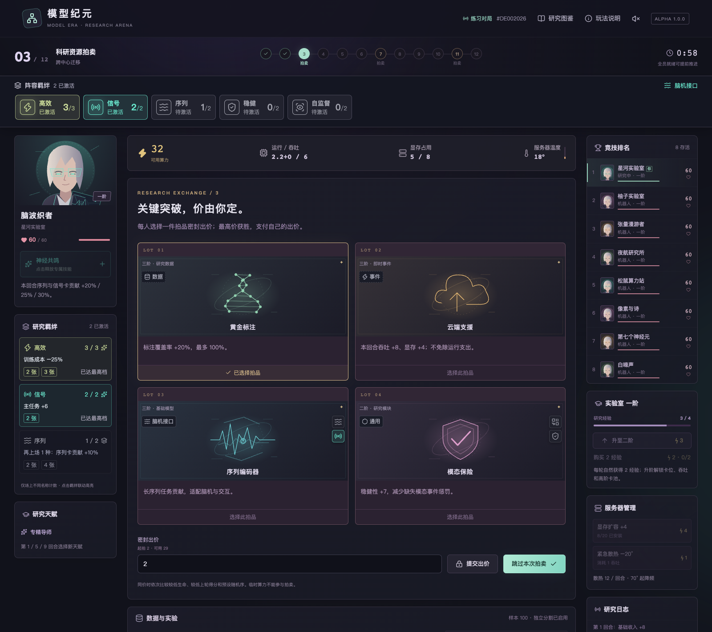
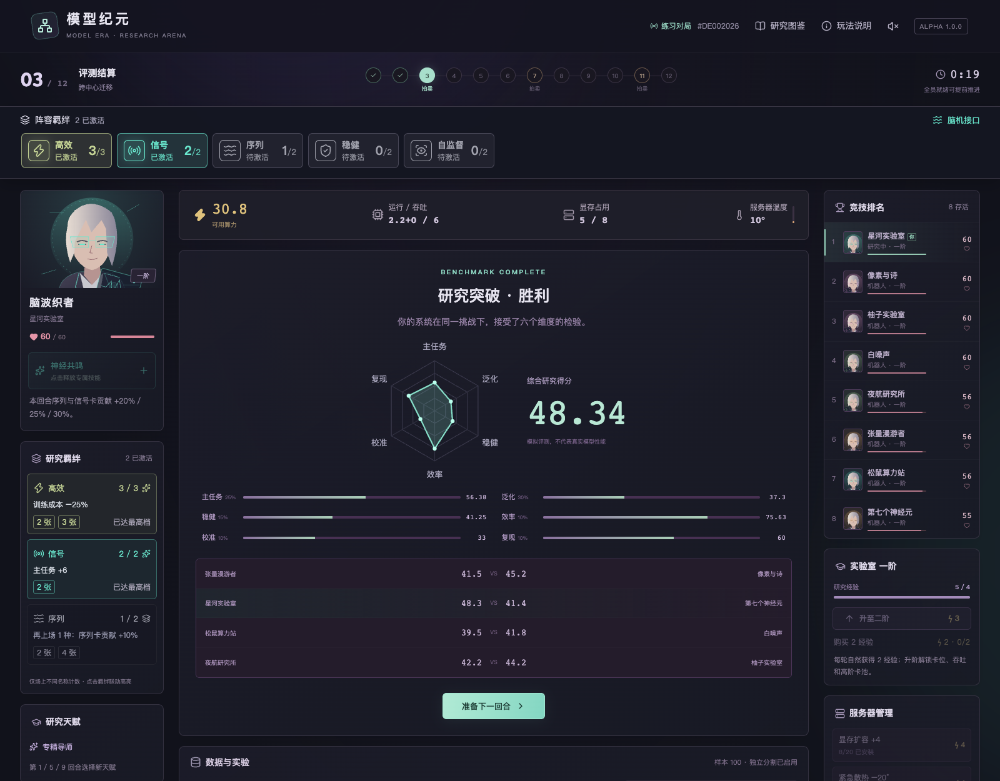
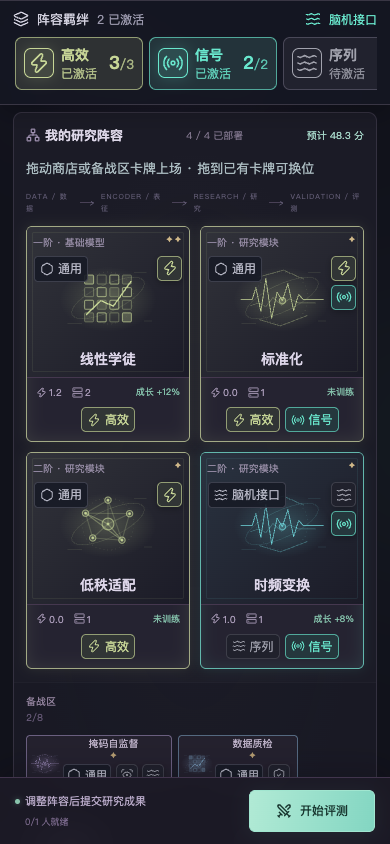
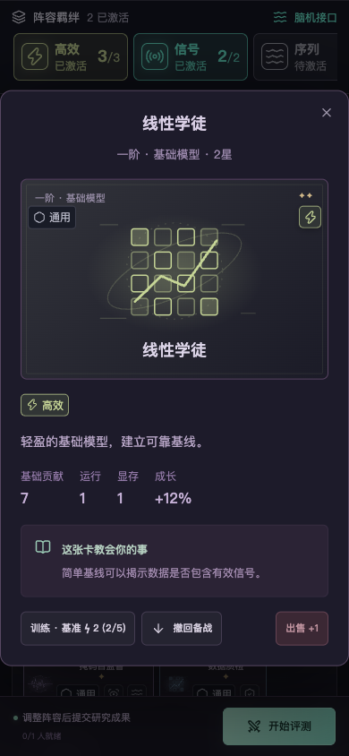
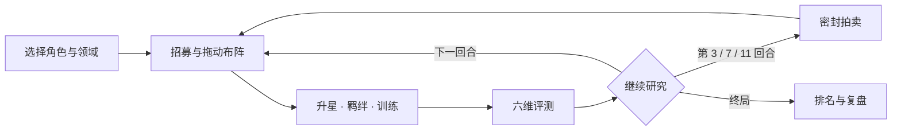

<div align="center">

# 模型纪元 · 科研竞技场

**把研究方向变成阵容，把有限算力变成策略。**

一款 AI 科研主题的多人策略卡牌游戏。选择研究领航员，招募模型与模块，在 12 回合的研究、拍卖与评测中构筑自己的实验室。

**12 位领航员 · 6 个领域 · 35 张卡牌 · 8 人竞技**

[游戏画面](#游戏画面) · [怎么玩](#怎么玩) · [本地运行](#本地运行) · [开发与扩展](#开发与扩展)



</div>

## 游戏画面

以下截图来自本地演示对局，展示实际界面；阵容和回合为展示玩法而预置。

### 拖动布阵，让研究体系亮起来

商店和备战区的模型、模块可以直接拖到场上。顶部常驻羁绊栏显示当前构筑；卡牌上的同款符号与阵容联动，达到人数门槛后亮起专属颜色。



### 关键资源，密封竞价

第 **3 / 7 / 11** 回合进入拍卖。选择一件拍品出价，最高价获胜并支付自己的出价；还要为阵容运行留足预算。



### 六个维度，看清构筑的强项

每回合的研究课题会影响评分。主任务、泛化、稳健、效率、校准、复现共同决定表现，雷达图和分项条帮助你决定下一轮该补什么。



### 手机也能操作

触屏拖动和鼠标拖动共用同一套规则。浏览阵容时羁绊栏保持在顶部；点击卡牌可查看详情并执行部署、训练或撤回。

<div align="center">
  
  
</div>

## 有哪些玩法

| 系统 | 你可以做什么 |
| --- | --- |
| 研究领航员 | 从 12 位角色中选择，围绕主动技能与被动天赋构筑 |
| 研究领域 | 脑机接口、医学影像、多组学、推理智能、具身智能、数据科学 |
| 卡牌构筑 | 购买、刷新、锁店、备战、拖动部署、换位、出售 |
| 自动升星 | 场上与备战区凑齐 **3 张同名同星**卡牌，自动合成，最高 3 星 |
| 研究羁绊 | 12 类独立符号；灰色待激活，达标变彩色，点击可高亮关联卡牌 |
| 资源调度 | 平衡可用算力、当轮吞吐、显存和服务器温度 |
| 研究成长 | 训练卡牌、清洗数据、完善标注、做消融和重复实验 |
| 实验室与天赋 | 六阶实验室；第 1 / 5 / 9 回合选择永久天赋 |
| 竞技与房间 | 单人练习由机器人补齐；好友通过房间码加入，最多 8 人 |
| 持久化对局 | 服务端保存进度，同一浏览器可刷新恢复当前对局 |

游戏数值是为策略体验设计的模拟评分，不代表真实模型性能；运行游戏无需模型 API Key，也不会发起真实训练或图像生成请求。

## 怎么玩

1. **选择方向**：选一位研究领航员、一个主领域，为实验室取名。点击「开始研究」进入单人练习，或在「好友房间」创建、加入对局。
2. **搭建基线**：从商店招募模型和模块，拖到阵容空位。数据、设备和事件卡购买后直接生效，各有类别符号。
3. **发展构筑**：观察顶部羁绊计数，补齐缺少的不同卡牌；收集重复卡自动升星，用训练和数据操作加强阵容。
4. **管理预算**：购买会消耗算力，训练还占用吞吐；评测时阵容仍需运行资源。显存不足、过热或预算不足会影响表现。
5. **提交评测**：准备好后点击「开始评测」。全体真人就绪可提前推进，否则等待倒计时。前两回合是不会损失生命的热身。
6. **复盘到终局**：依据课题、拍卖与评分继续调整，最多进行 12 回合。最终按剩余生命、累计得分、本轮得分依次排名。



### 操作速查

| 操作 | 方法 |
| --- | --- |
| 从商店直接上场 | 将模型／模块拖到阵容，成功部署时完成购买 |
| 从备战区上场 | 将卡牌拖到空位；拖到已有卡牌时替换，原卡回到备战区 |
| 调整站位 | 将场上卡牌拖到另一个位置 |
| 撤回卡牌 | 拖回备战区，或点开详情选择「撤回备战」 |
| 触屏拖动 | 手指按住卡牌后拖动；靠近屏幕边缘可自动滚动 |
| 自动升星 | 三张同名同星自动合成，保留最高训练成长与训练次数 |
| 查看羁绊 | 点击顶部或侧栏的羁绊符号，查看效果并高亮相关卡牌 |

### 羁绊如何计数

**只计算场上不同名称的卡牌**。相同卡牌升星不会增加羁绊人数，备战区也不计入。

例如：线性学徒 + 标准化，激活「高效」第一档；再上场低秩适配，达到第二档。顶部图标、卡牌符号和侧栏效果一起更新，撤回成员后会重新计算。

| 羁绊 | 激活门槛（不同卡牌数） | 效果 |
| --- | --- | --- |
| 序列 | 2 / 4 | 序列卡贡献 +10% / +20% |
| 信号 | 2 | 主任务 +6 |
| 视觉 | 2 | 主任务 +6 |
| 多尺度 | 2 | 主任务 +5 |
| 图谱 | 2 | 泛化 +5 |
| 组学 | 2 | 泛化 +6 |
| 融合 | 2 / 3 | 融合卡贡献 +10% / +18% |
| 稳健 | 2 / 4 | 稳健 +6 / +10 |
| 推理 | 2 | 校准 +6 |
| 高效 | 2 / 3 | 训练成本 −15% / −25% |
| 自监督 | 2 / 4 | 训练成长 +10% / +20% |
| 交互 | 2 | 泛化 +6 |

## 本地运行

推荐 **Node.js 24 LTS + npm**。项目需要 Node.js 22.13 或更新版本，使用 Cloudflare 的本地运行环境模拟 Worker 与 D1；本地游玩无需 Cloudflare 账号。

```bash
git clone https://github.com/AstarZZZ/model-era-arena.git
cd model-era-arena

# 使用 nvm 时，可先执行 nvm use
npm ci
npm run db:init
npm run dev
```

打开 **http://localhost:5173**。

`db:init` 应用 `drizzle/` 中的迁移，可重复执行。游戏数据保存在本机 `.wrangler/state/`；首次运行前需要初始化数据库。完整说明和常见问题见 [本地开发指南](docs/DEVELOPMENT.md)。

```bash
npm test             # 引擎规则与 API 集成测试
npm run typecheck    # TypeScript 检查
npm run build        # 生成 Worker 与客户端产物
npm start            # 在本地运行构建后的版本
```

多人游玩需要所有参与者访问**同一个运行实例**；不同电脑各自启动的本地数据库不会共享房间。该应用包含服务端和数据库，不能直接用 GitHub Pages 托管成完整游戏。

## 开发与扩展

**React 19 · TypeScript · Vinext / Vite · Tailwind CSS 4 · Cloudflare Workers · D1 / SQLite**

界面使用 SVG 角色与卡牌插画、CSS 动效和可关闭的 Web Audio 音效。核心规则在服务端执行，客户端只提交动作；房间状态通过版本检查更新，操作 ID 用于避免重复提交。

```text
app/
  page.tsx                游戏主界面与阶段切换
  art.tsx                 SVG 角色、卡牌插画
  trait-emblems.tsx       羁绊及领域符号
  use-card-drag.ts        鼠标、触屏与手写笔拖动
  api/game/route.ts      对局 API 与会话
lib/game/
  content.ts             角色、领域、卡牌、天赋与课题
  engine.ts              招募、训练、合成、拍卖、评分与机器人
  synergies.ts           羁绊门槛与展示数据
  store.ts               D1 存储访问
db/ · drizzle/           数据结构与迁移
tests/                   规则与 API 集成测试
docs/                    开发说明、扩展指南与游戏截图
```

想增加角色、卡牌或新课题，从 [扩展指南](docs/EXTENDING.md) 和 `lib/game/content.ts` 开始。涉及数值规则时，请同步更新引擎、界面说明与测试。

当前为可玩 Alpha：研究流程与数据指标经过抽象，尚未实现手动研究 DAG、完整专属天赋树或真实训练。Vinext 本身也处于 beta 阶段，依赖版本以锁文件为准。

## 版权与依赖

本仓库公开提供源码，原创部分暂未指定开源许可证。随仓库分发的第三方代码保留各自声明，详见 [第三方说明](THIRD_PARTY_NOTICES.md)；其余依赖遵循各自包内许可证。
